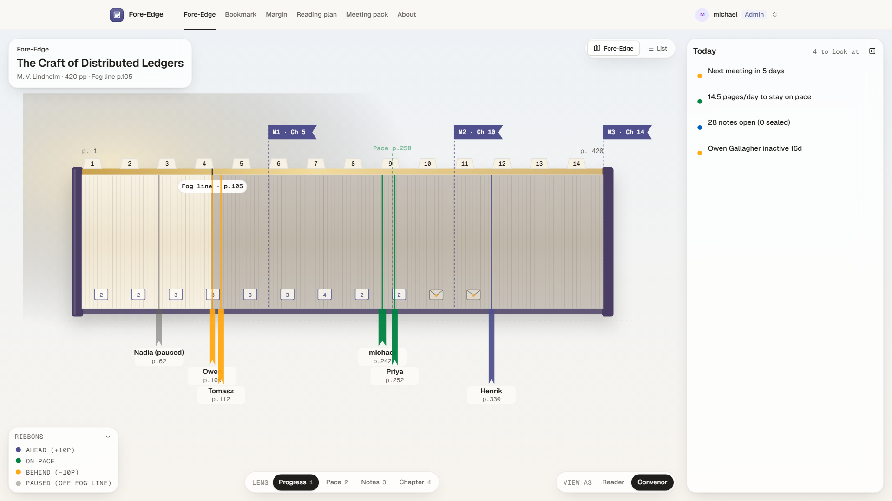

# Fore-Edge

Reading pace worked back from each fortnightly meeting date, discussion notes that stay sealed until your bookmark reaches that chapter, and a fog line that marks the slowest active reader so nobody spoils the book.




## This repository

```text
apps/fore-edge/   the app: React + Vite frontend, Rayfin data model (rayfin/), tests, demo walkthrough
shared/         shared package (@x10/shared): data store, sign-in runtime, UI kit, charts
tools/          deploy, seed, SQL and secrets-check scripts
```

Quick start (no Fabric tenant needed, runs in demo mode with sample data):

```bash
npm install
npm run dev
```

## The problem & standard

Technical study circles lose momentum when half the group falls behind by meeting two, keen readers accidentally spoil later chapters, and the convenor cannot tell who needs a nudge or whether to move the date. Fore-Edge applies deterministic effective-day pacing (`WEEKEND_WEIGHT = 0.5`), personal median pages-per-hour catch-up estimates, and domain-enforced chapter spoiler locks.

## What it looks like

A thick hardback lying on a reading table, seen from its open fore-edge under a warm lamp: fine page lines, gilt top edge, cloth boards, chapter tabs, meeting flags, silk ribbon markers for each reader, and a fog line that shades unread pages. Lenses switch between **Progress**, **Pace**, **Notes**, and **Chapter**; tools include **Bookmark**, **Margin**, **Reading plan**, and **Meeting pack**; **ViewToggle** switches to an accessible list view.

## Prerequisites

- Microsoft Fabric Apps workload enabled in a workspace on a capacity
- Edit permission on the workspace
- Node.js 20+

## Run locally

```bash
npm install # at repo root
cd apps/fore-edge
npm run dev        # demo mode with deterministic seed & persona switcher (port 5339)
npm run dev:fabric # connected to Microsoft Fabric
```

## Deploy

```bash
cd apps/fore-edge
npx rayfin up --workspace-id <id>
```

## Seed

```bash
cd apps/fore-edge
npm run seed:fabric -- --admin-email you@org.com
```

The first seeded persona is the Convenor (admin). Additional convenors can be granted admin status in the `Person` entity.

## How it works

| Entity | Purpose | Row security |
| --- | --- | --- |
| `Book` | Active book metadata and total pages | Read: authenticated; Write: `claims.sub.eq(item.convenorSub)` |
| `Chapter` | Chapter number, title, start/end pages | Authenticated (convenor enforced in domain) |
| `Meeting` | Fortnightly meeting date & target chapter | Authenticated (convenor enforced in domain) |
| `Membership` | Reader status (`reading`, `paused`, `finished`, `dropped`) | Read: authenticated; Write: `claims.sub.eq(item.readerSub)` |
| `Progress` | Dated page and minutes log | Read: authenticated; Write: `claims.sub.eq(item.readerSub)` |
| `Note` | Chapter margin note (`question`, `insight`, `disagreement`) | Read: authenticated; Write: `claims.sub.eq(item.authorSub)` |

## Known limits

- Spoiler filtering on `Note` is enforced in the app domain rather than as a database row policy (clearly disclosed in the UI).
- Convenor-only writes on `Chapter` and `Meeting` are enforced in domain functions.

## Later

- Multiple concurrent books per circle
- Calendar export (.ics) for meeting dates

## Gallery

**12 Days of Fabric Apps: Day 11.7 – Fore-Edge**

Fore-Edge keeps a technical study circle reading together without spoilers. Seen from the gilt fore-edge of a hardback under a warm lamp, each reader appears as a silk ribbon marker, chapter tabs line the top edge, and a fog line shades pages beyond the slowest active reader. Discussion notes stay sealed until your bookmark reaches their chapter, while weekend-weighted pacing and personal reading speed show exactly how long it takes to catch up. Built for AI at Work.

Tags: `Partner | 12 Days of Fabric Apps`

## License

MIT. See [LICENSE](LICENSE).
